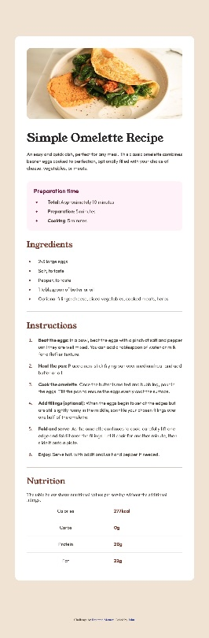

# Frontend Mentor - Recipe page solution

This is a solution to the [Recipe page challenge on Frontend Mentor](https://www.frontendmentor.io/challenges/recipe-page-KiTsR8QQKm). Frontend Mentor challenges help you improve your coding skills by building realistic projects. 

## Table of contents

- [Overview](#overview)
  - [Screenshot](#screenshot)
  - [Links](#links)
- [My process](#my-process)
  - [Built with](#built-with)
  - [What I learned](#what-i-learned)
  - [Continued development](#continued-development)
  - [AI Collaboration](#ai-collaboration)
- [Author](#author)

## Overview

### Screenshot

### Links

- Solution URL: [GitHub repository](https://github.com/RoomForEpsilon/recipe-page)
- Live Site URL: [Live recipe page](https://roomforepsilon.github.io/recipe-page/)

## My process

### Built with

- Semantic HTML5 markup
- CSS custom properties
- Flexbox
- Mobile-first workflow

### What I learned

I'm getting better with CSS and Figma. I'm beginning to see patterns in the designs, and I'm getting more comfortable with my code organization. There's still a way for me to go, though.

This was my first time designing for mobile, tablet, and desktop. Once I finished the mobile layout, the tablet and desktop layouts quickly followed because there weren't many differences. Interestingly, I was able to catch some of my mistakes when I viewed the layout at larger screen sizes.

I improved my understanding of the article tag.  Before this project, I thought an article could have a main tag inside of it; however, an article is supposed to be a self contained piece inside of the web page.  It doesn't make sense to have a main tag inside of an article.

I also learned about aria elements.  I decided to put one on my nutrition table, because the design didn't include a caption to the table.  In some ways, I think I'm placating the AI suggestions.  I feel like the suggestion brought up a reasonable problem, but I feel like the reasonable solution, adding a table caption, is not in the design file.

### Continued development

I still need to work on CSS. I think I'm ready for slightly more complex projects—but only slightly!

### AI Collaboration

I used ChatGPT as the duck in rubber duck debugging.

## Author

- Frontend Mentor - [@RoomForEpsilon](https://www.frontendmentor.io/profile/RoomForEpsilon)
